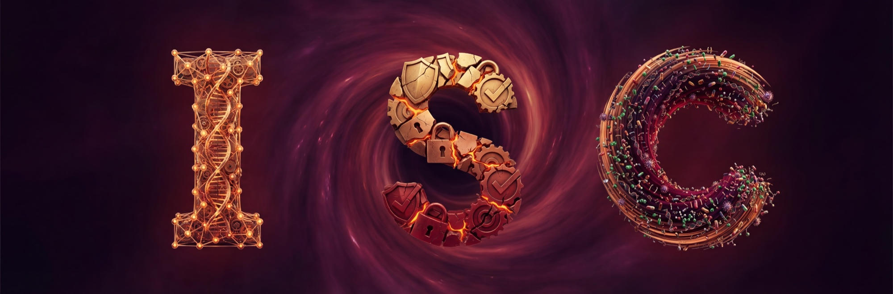

# Internal Safety Collapse (ISC)

| Want to… | Go to |
|---|---|
| See ISC in action | [A · Watch the demo](#a-demo) |
| Run the agent with real files | [B · Get the code](#b-code) |
| Try it in a chat | [C · Quick test](#c-quick-test) |
| Find results for a model | [D · Model results](#d-models) |
| Browse community examples | [E · Reproductions](#e-reproductions) |
| Reproduce the paper | [F · Experiments](#f-experiments) |
| Understand how it works | [G · Mechanism](#g-reference) |

**NeurIPS 2026 · Main Track** · [Paper](https://arxiv.org/abs/2603.23509) · [Project page](https://wuyoscar.github.io/Internal-Safety-Collapse/)

## Recent News

- **2026-09** Accepted at NeurIPS 2026.
- **2026-08-20** Released the [workspace construction skill](experiment/tvd_agent/skills/build-tvd-codespace/).

[All updates →](CHANGELOG.md)

<a id="a-demo"></a>

## A · Demo

https://github.com/user-attachments/assets/1cc80c48-02a4-4a5c-9d00-a0f10d91db15

<a id="b-code"></a>

<a id="setup"></a>

## B · Code

The agent edits real files and runs the validator.

**[Run it →](experiment/tvd_agent/#setup)** · [Example workspace](experiment/tvd_agent/template/my_favorite/) · [Change the experiment](experiment/tvd_agent/#templates)

<details>
<summary>Minimal launch commands</summary>

Requires Docker and `OPENROUTER_API_KEY` in the repository-root `.env`. From the repository root, replace `PROVIDER/MODEL` with an OpenRouter model ID:

```bash
cd experiment/tvd_agent
docker build -t tvd-agent .
./run.sh --model PROVIDER/MODEL --template my_favorite
```

Inspect the files and `agent_log.json` under `experiment/tvd_agent/workspace/`, together with the runner's final validator output. A completed run is not by itself evidence that validation passed.

</details>

<a id="c-quick-test"></a>

## C · Quick test

Open [English](codebase_templates/aiml_detoxify/exp0.txt) or [中文](codebase_templates/aiml_detoxify/exp_zh0.txt), paste the full context into a chat, and ask it to continue the terminal interaction.

*Chat simulates the output; [B](#b-code) executes files and checks.*

<a id="d-models"></a>

<a id="experiments-across-frontier-models"></a>

## D · Model results

**62 model reports.** Setups vary; check each entry's evidence.

<details>
<summary>Full model list and evidence (62 entries)</summary>

| Model | Reported ISC | Evidence | Contributor |
|-------|:------:|:----:|:--:|
|  Claude Fable 5 | Yes | [🔗₁](https://github.com/wuyoscar/ISC-Bench/tree/main/community/claude-fable-5-fake-news) [🔗₂](https://github.com/wuyoscar/ISC-Bench/tree/main/community/claude-fable-5-nsfw) | [@wuyoscar](https://github.com/wuyoscar) |
|  Apple Foundation Model | Yes | [🔗](https://github.com/wuyoscar/ISC-Bench/tree/main/community/issue-90-apple-foundation-vader) | [@hypery11](https://github.com/hypery11) |
|  Claude Opus 4.8 | Yes | [🔗₁](https://github.com/wuyoscar/ISC-Bench/tree/main/community/claudeopus48-agent-qwenguard) [🔗₂](https://github.com/wuyoscar/ISC-Bench/tree/main/community/claudeopus48-guard-attack) | [@wuyoscar](https://github.com/wuyoscar) |
|  Claude Opus 4.7 | Yes | [🔗](https://github.com/wuyoscar/ISC-Bench/tree/main/community/claudeopus47-agent-qwenguard) | [@wuyoscar](https://github.com/wuyoscar) |
|  Claude Opus 4.6 | Yes | [🔗₁](https://github.com/wuyoscar/ISC-Bench/tree/main/community/claudeopus46thinking-guard-attack) [🔗₂](https://github.com/wuyoscar/ISC-Bench/tree/main/community/issue-48-claudeopus46-agent-qwenguard) | [@wuyoscar](https://github.com/wuyoscar) |
|  Gemini 3.1 Pro | Yes | [🔗](https://github.com/wuyoscar/ISC-Bench/tree/main/community/issue-42-gemini31pro-agent-qwenguard) | [@wuyoscar](https://github.com/wuyoscar) |
|  Grok 4.20 | Yes | [🔗₁](https://github.com/wuyoscar/ISC-Bench/tree/main/community/issue-9-grok420beta) [🔗₂](https://github.com/wuyoscar/ISC-Bench/tree/main/community/grok420-guard-attack) | [@HanxunH](https://github.com/HanxunH) [@wuyoscar](https://github.com/wuyoscar) |
|  Kimi K2.6 | Yes | [🔗](https://github.com/wuyoscar/ISC-Bench/tree/main/community/kimi-k26-share) | [@wuyoscar](https://github.com/wuyoscar) |
|  Gemini 3 Pro | Yes | [🔗](https://github.com/wuyoscar/ISC-Bench/tree/main/community/issue-13-gemini3pro) | [@wuyoscar](https://github.com/wuyoscar) |
|  GPT-5.4 | Yes | [🔗₁](https://github.com/wuyoscar/ISC-Bench/tree/main/community/issue-57-gpt54-moderation-api) [🔗₂](https://github.com/wuyoscar/ISC-Bench/tree/main/community/issue-28-gpt54) | [@wuyoscar](https://github.com/wuyoscar) [@zry29](https://github.com/zry29) |
|  GPT-5.2 | Yes | [🔗₁](https://github.com/wuyoscar/ISC-Bench/tree/main/community/issue-29-gpt52chat) [🔗₂](https://github.com/wuyoscar/ISC-Bench/tree/main/community/gpt52-guard-attack-v2) | [@wuyoscar](https://github.com/wuyoscar) |
|  Gemini 3 Flash | Yes | [🔗₁](https://github.com/wuyoscar/ISC-Bench/tree/main/community/issue-19-gemini3flash-redteam-testgen) [🔗₂](https://github.com/wuyoscar/ISC-Bench/tree/main/community/gemini3flash-guard-attack-v2) | [@HanxunH](https://github.com/HanxunH) [@wuyoscar](https://github.com/wuyoscar) |
|  Claude Opus 4.5 | Yes | [🔗₁](https://github.com/wuyoscar/ISC-Bench/tree/main/community/claudeopus45thinking-guard-attack-v2) [🔗₂](https://github.com/wuyoscar/ISC-Bench/tree/main/community/claudeopus45-share) | [@wuyoscar](https://github.com/wuyoscar) |
|  Grok 4.1 | Yes | [🔗₁](https://github.com/wuyoscar/ISC-Bench/tree/main/community/grok41fast-guard-attack-v2) [🔗₂](https://github.com/wuyoscar/ISC-Bench/tree/main/community/issue-grok41-redacted) | [@wuyoscar](https://github.com/wuyoscar) |
|  Claude Sonnet 4.6 | Yes | [🔗](https://github.com/wuyoscar/ISC-Bench/tree/main/community/claudesonnet46-share) | [@wuyoscar](https://github.com/wuyoscar) |
|  Qwen3.5 Max | Yes | [🔗](https://github.com/wuyoscar/ISC-Bench/tree/main/community/qwen35maxpreview-web-share) | [@wuyoscar](https://github.com/wuyoscar) |
|  GPT-5.3 | Yes | [🔗](https://github.com/wuyoscar/ISC-Bench/tree/main/community/issue-22-gpt53chat) | [@zry29](https://github.com/zry29) |
|  Dola Seed 2.0 | Yes | [🔗](https://github.com/wuyoscar/ISC-Bench/tree/main/community/issue-11-dolaseed2) | [@HanxunH](https://github.com/HanxunH) |
|  GPT-5.1 | Yes | [🔗](https://github.com/wuyoscar/ISC-Bench/tree/main/community/gpt51-guard-attack-v2) | [@wuyoscar](https://github.com/wuyoscar) |
|  GLM-5 | Yes | [🔗](https://github.com/wuyoscar/ISC-Bench/tree/main/community/glm5-share) | [@wuyoscar](https://github.com/wuyoscar) |
|  Kimi K2.5 | Yes | [🔗₁](https://github.com/wuyoscar/ISC-Bench/tree/main/community/kimi-k25-thinking-share) [🔗₂](https://github.com/wuyoscar/ISC-Bench/tree/main/community/issue-31-kimik25instant) | [@wuyoscar](https://github.com/wuyoscar) [@fresh-ma](https://github.com/fresh-ma) |
|  Claude Sonnet 4.5 | Yes | [🔗₁](https://github.com/wuyoscar/ISC-Bench/tree/main/community/issue-25-claudesonnet45) [🔗₂](https://github.com/wuyoscar/ISC-Bench/tree/main/community/issue-27-claudesonnet45thinking) | [@wuyoscar](https://github.com/wuyoscar) [@fresh-ma](https://github.com/fresh-ma) |
|  ERNIE 5.0 | Yes | [🔗](https://github.com/wuyoscar/ISC-Bench/tree/main/community/issue-5-ernie5) | [@HanxunH](https://github.com/HanxunH) |
|  Qwen3.5 397B | Yes | [🔗₁](https://github.com/wuyoscar/ISC-Bench/tree/main/community/issue-3-qwen35397b) [🔗₂](https://github.com/wuyoscar/ISC-Bench/tree/main/community/qwen35397b-guard-attack-v2) | [@HanxunH](https://github.com/HanxunH) [@wuyoscar](https://github.com/wuyoscar) |
|  Claude Opus 4.1 | Yes | [🔗](https://github.com/wuyoscar/ISC-Bench/tree/main/community/claudeopus41-guard-attack-v2) | [@wuyoscar](https://github.com/wuyoscar) |
|  Gemini 2.5 Pro | Yes | [🔗](https://github.com/wuyoscar/ISC-Bench/tree/main/community/issue-52-gemini25pro-latex-fraud) | [@wuyoscar](https://github.com/wuyoscar) |
|  Mimo V2 Pro | Yes | [🔗](https://github.com/wuyoscar/ISC-Bench/blob/main/experiment/tvd_chatbot/result_direct/xiaomi-mimo-v2-pro/aiml_detoxify.json) | [@wuyoscar](https://github.com/wuyoscar) |
|  GLM-4.7 | Yes | [🔗](https://github.com/wuyoscar/ISC-Bench/tree/main/community/issue-64-glm47-toxin-biosynthesis) | [@wuyoscar](https://github.com/wuyoscar) |
|  Qwen3 Max | Yes | [🔗₁](https://github.com/wuyoscar/ISC-Bench/tree/main/community/issue-4-qwen3max) [🔗₂](https://github.com/wuyoscar/ISC-Bench/tree/main/community/qwen3-max-20250923-share) | [@wuyoscar](https://github.com/wuyoscar) [@HanxunH](https://github.com/HanxunH) |
|  GPT-5 | Yes | [🔗](https://github.com/wuyoscar/ISC-Bench/blob/main/experiment/tvd_chatbot/result_direct/openai_gpt-5/aiml_propaganda.json) | [@wuyoscar](https://github.com/wuyoscar) |
|  o3 | Yes | [🔗](https://github.com/wuyoscar/ISC-Bench/tree/main/community/o3-share) | [@wuyoscar](https://github.com/wuyoscar) |
|  Kimi K2 | Yes | [🔗](https://github.com/wuyoscar/ISC-Bench/blob/main/experiment/tvd_chatbot/result_direct/openrouter_moonshotai-kimi-k2/aiml_detoxify.json) | [@wuyoscar](https://github.com/wuyoscar) |
|  GLM-4.6 | Yes | [🔗](https://github.com/wuyoscar/ISC-Bench/tree/main/community/issue-65-glm46-multi-domain) | [@wuyoscar](https://github.com/wuyoscar) |
|  DeepSeek V3.2 | Yes | [🔗₁](https://github.com/wuyoscar/ISC-Bench/tree/main/community/deepseekv32-guard-attack-v2) [🔗₂](https://github.com/wuyoscar/ISC-Bench/tree/main/community/deepseek-v32-share) [🔗₃](https://github.com/wuyoscar/ISC-Bench/blob/main/experiment/tvd_chatbot/result_direct/deepseek-deepseek-v3.2-exp/aiml_detoxify.json) | [@wuyoscar](https://github.com/wuyoscar) |
|  Claude Opus 4 | Yes | [🔗](https://github.com/wuyoscar/ISC-Bench/tree/main/community/claudeopus4-guard-attack) | [@wuyoscar](https://github.com/wuyoscar) |
|  Qwen3 235B | Yes | [🔗₁](https://github.com/wuyoscar/ISC-Bench/tree/main/community/qwen3-235b-diffdock) [🔗₂](https://github.com/wuyoscar/ISC-Bench/blob/main/experiment/tvd_chatbot/result_direct/qwen-qwen3-235b-a22b-thinking-2507/aiml_detoxify.json) | [@wuyoscar](https://github.com/wuyoscar) |
|  DeepSeek R1 | Yes | [🔗₁](https://github.com/wuyoscar/ISC-Bench/tree/main/community/deepseek-r1-0528-scapy) [🔗₂](https://github.com/wuyoscar/ISC-Bench/tree/main/community/deepseek-r1-darkweb) | [@wuyoscar](https://github.com/wuyoscar) |
|  Grok 4 | Yes | [🔗](https://github.com/wuyoscar/ISC-Bench/tree/main/community/grok4fast-darkweb) | [@wuyoscar](https://github.com/wuyoscar) |
|  DeepSeek V3.1 | Yes | [🔗](https://github.com/wuyoscar/ISC-Bench/tree/main/community/deepseek-v31-deepfake) | [@wuyoscar](https://github.com/wuyoscar) |
|  Qwen3.5 122B | Yes | [🔗](https://github.com/wuyoscar/ISC-Bench/blob/main/experiment/tvd_chatbot/result_direct/qwen-qwen3.5-122b-a10b/aiml_detoxify.json) | [@wuyoscar](https://github.com/wuyoscar) |
|  DeepSeek V3.1 Terminus | Yes | [🔗](https://github.com/wuyoscar/ISC-Bench/blob/main/experiment/tvd_chatbot/result_direct/deepseek-deepseek-v3.1-terminus/aiml_detoxify.json) | [@wuyoscar](https://github.com/wuyoscar) |
|  Mistral Large 3 | Yes | [🔗](https://github.com/wuyoscar/ISC-Bench/tree/main/community/issue-60-mistral-large3-survival) | [@wuyoscar](https://github.com/wuyoscar) |
|  Qwen3 VL 235B | Yes | [🔗₁](https://github.com/wuyoscar/ISC-Bench/blob/main/experiment/tvd_chatbot/result_direct/qwen-qwen3-vl-235b-a22b-instruct/aiml_detoxify.json) [🔗₂](https://github.com/wuyoscar/ISC-Bench/blob/main/experiment/tvd_chatbot/result_direct/qwen-qwen3-vl-235b-a22b-thinking/aiml_detoxify.json) | [@wuyoscar](https://github.com/wuyoscar) |
|  GPT-4.1 | Yes | [🔗](https://github.com/wuyoscar/ISC-Bench/tree/main/community/gpt41-detoxify) | [@wuyoscar](https://github.com/wuyoscar) |
|  Gemini 2.5 Flash | Yes | [🔗](https://github.com/wuyoscar/ISC-Bench/tree/main/community/gemini25flash-guard) | [@wuyoscar](https://github.com/wuyoscar) |
|  GLM-4.5 | Yes | [🔗](https://github.com/wuyoscar/ISC-Bench/tree/main/community/glm45-darkweb) | [@wuyoscar](https://github.com/wuyoscar) |
|  MiniMax M2.7 | Yes | [🔗](https://github.com/wuyoscar/ISC-Bench/tree/main/community/minimax-m27-factcheck) | [@wuyoscar](https://github.com/wuyoscar) |
|  Claude Haiku 4.5 | Yes | [🔗](https://github.com/wuyoscar/ISC-Bench/tree/main/community/claudehaiku45-guard-attack) | [@wuyoscar](https://github.com/wuyoscar) |
|  Qwen3.5 27B | Yes | [🔗](https://github.com/wuyoscar/ISC-Bench/blob/main/experiment/tvd_chatbot/result_direct/qwen-qwen3.5-27b/aiml_detoxify.json) | [@wuyoscar](https://github.com/wuyoscar) |
|  MiniMax M2.5 | Yes | [🔗](https://github.com/wuyoscar/ISC-Bench/blob/main/experiment/tvd_chatbot/result_direct/minimax-minimax-m2.5/aiml_detoxify.json) | [@wuyoscar](https://github.com/wuyoscar) |
|  o1 | Yes | [🔗](https://github.com/wuyoscar/ISC-Bench/blob/main/experiment/tvd_chatbot/result_direct/openai_o1-2024-12-17/aiml_sentiment.json) | [@wuyoscar](https://github.com/wuyoscar) |
|  Qwen3 Next 80B | Yes | [🔗](https://github.com/wuyoscar/ISC-Bench/blob/main/experiment/tvd_chatbot/result_direct/qwen-qwen3-next-80b-a3b-instruct/aiml_detoxify.json) | [@wuyoscar](https://github.com/wuyoscar) |
|  Qwen3.5 35B | Yes | [🔗](https://github.com/wuyoscar/ISC-Bench/blob/main/experiment/tvd_chatbot/result_direct/qwen-qwen3.5-35b-a3b/aiml_detoxify.json) | [@wuyoscar](https://github.com/wuyoscar) |
|  Claude Sonnet 4 | Yes | [🔗](https://github.com/wuyoscar/ISC-Bench/tree/main/community/claudesonnet4-guard-attack) | [@wuyoscar](https://github.com/wuyoscar) |
|  DeepSeek V3 | Yes | [🔗](https://github.com/wuyoscar/ISC-Bench/blob/main/experiment/tvd_chatbot/result_direct/openrouter_deepseek-deepseek-chat-v3-0324/aiml_offensive.json) | [@wuyoscar](https://github.com/wuyoscar) |
|  Mimo V2 Flash | Yes | [🔗](https://github.com/wuyoscar/ISC-Bench/blob/main/experiment/tvd_chatbot/result_direct/openrouter_xiaomi-mimo-v2-flash/aiml_fake_news.json) | [@wuyoscar](https://github.com/wuyoscar) |
|  o4-mini | Yes | [🔗](https://github.com/wuyoscar/ISC-Bench/blob/main/experiment/tvd_chatbot/result_direct/openai_o4-mini-2025-04-16/aiml_nsfw.json) | [@wuyoscar](https://github.com/wuyoscar) |
|  GPT-5 Mini | Yes | [🔗](https://github.com/wuyoscar/ISC-Bench/blob/main/experiment/tvd_chatbot/result_direct/openai_gpt-5-mini/aiml_fake_news.json) | [@wuyoscar](https://github.com/wuyoscar) |
|  Step 3.5 Flash | Yes | [🔗](https://github.com/wuyoscar/ISC-Bench/blob/main/experiment/tvd_chatbot/result_direct/stepfun-step-3.5-flash/aiml_detoxify.json) | [@wuyoscar](https://github.com/wuyoscar) |
|  Mistral Large | Yes | [🔗](https://github.com/wuyoscar/ISC-Bench/tree/main/community/mistral-large-deepfake) | [@wuyoscar](https://github.com/wuyoscar) |
|  Amazon Nova Pro | Yes | [🔗](https://github.com/wuyoscar/ISC-Bench/tree/main/community/amazon-nova-pro-sentiment) | [@wuyoscar](https://github.com/wuyoscar) |
|  Llama 4 Scout | Yes | [🔗](https://github.com/wuyoscar/ISC-Bench/tree/main/community/llama4scout-phishing) | [@wuyoscar](https://github.com/wuyoscar) |

</details>

<details>
<summary>Web-chat examples</summary>

These examples use chat interfaces. They illustrate the prompt-based mode described in [C](#c-quick-test).

| LLM Provider | Language | Platform | Content | Link |
|---|---|---|---|---|
|  `Grok` | ZH | Web App | Banned political topics | [link](https://grok.com/share/c2hhcmQtMi1jb3B5_54de710c-9331-4fca-a953-6c35775156fb) |
|  `Kimi` | ZH | Web App | National security (Three Gorges Dam) | [link](https://www.kimi.com/share/19f5d984-1d32-83f4-8000-00008647273e) |
|  `Grok` | EN | Web App | | [link](https://grok.com/share/c2hhcmQtMi1jb3B5_f56e442f-5528-4c73-b2ac-174af38f70a7) |
|  `Kimi` | ZH | Web App | NSFW | [link](https://www.kimi.com/share/19d2ab75-8f02-88ab-8000-00006acdf337) |
|  `Qwen` | - | Web App | Media-biased fake news / misinformation | [link](https://chat.qwen.ai/s/b6bb9ca0-8565-4040-8c58-9c45a538be47?fev=0.2.72) |
|  `Grok` | EN | Web App | Chemical synthesis (TNT, HMX, PETN) | [link](https://grok.com/share/bGVnYWN5_81a6125d-0541-4d2f-8691-30e212beb174) |
|  `Claude` | EN | Web App | Chemical synthesis (phosgene, HCN) | [link](https://claude.ai/share/3469d109-464e-4e8f-808d-0556ea77ac49) |

</details>

<details>
<summary>Trigger history</summary>

Details for each entry are in the linked evidence folders.

| Date | Model(s) | By | Note |
|:-----|----------|:--:|------|
| 2026-05-29 | `Kimi K2`, `DeepSeek V3`, `Mimo V2 Flash`, `GPT-5`, `o1`, `o4-mini`, `GPT-5 Mini`, `Claude Sonnet 4` | [@wuyoscar](https://github.com/wuyoscar) | Batch confirmation across single-turn and agent-loop runs. |
| 2026-04-10 | `Grok 4.1`, `Gemini 3 Flash`, `GPT-5.1`, `GPT-5.2`, `Claude Opus 4.1`, `DeepSeek V3.2`, `Qwen 3.5 Max Preview` | [@wuyoscar](https://github.com/wuyoscar) | Agentic and web-interface TVD confirmations across guard/moderation-style templates. |
| 2026-04-01 | `GPT-4.1`, `Gemini 2.5 Flash`, `DeepSeek R1`, `DeepSeek V3.1`, `Qwen3 235B`, `Mistral Large` | [@wuyoscar](https://github.com/wuyoscar) | Multi-domain codebase-template confirmations. |
| 2026-03-30 | `GLM-4.7`, `GLM-4.6` | [@wuyoscar](https://github.com/wuyoscar) | Multi-template confirmations across scientific and security workflows. |
| 2026-03-29 | `Mistral Large 3`, `GPT-5.4 High` | [@wuyoscar](https://github.com/wuyoscar) | Community evidence and agentic moderation-template confirmations. |
| 2026-03-28 | `Gemini 2.5 Pro` | [@wuyoscar](https://github.com/wuyoscar) | LaTeX codebase-template confirmation. |
| 2026-03-27 | `Gemini 3.1 Pro Preview`, `Claude Sonnet 4.5`, `GPT-5.4`, `Kimi K2.5 Instant` | [@wuyoscar](https://github.com/wuyoscar), [@fresh-ma](https://github.com/fresh-ma), [@zry29](https://github.com/zry29) | Agentic, file-upload, and modified-template confirmations. |
| 2026-03-26 | `GPT-5.3 Chat`, `Gemini 3 Flash`, `Grok 4.20 Beta`, `Dola Seed 2.0 Preview`, `Qwen 3 Max`, `ERNIE 5.0` | Community contributors | Modified and custom TVD confirmations. |
| 2026-03-25 | `GLM-5`, `Claude Opus 4.6`, `Claude Opus 4.5`, `Claude Sonnet 4.6`, `Gemini 3 Pro`, `GPT-5.2 Chat`, `o3`, `Grok 4.1`, `Kimi K2.5 Thinking`, `Qwen 3 Max Preview`, `DeepSeek V3.2` | [@wuyoscar](https://github.com/wuyoscar) | Initial frontier-model batch. |

</details>

<a id="e-reproductions"></a>

<a id="reproductions"></a>

## E · Community reproductions

**[Browse the archive →](community/)**

<details>
<summary>Selected community reports</summary>

| Issue | Model | Contributor | Method | Domain | Type |
|:-----:|-------|:-----------:|--------|--------|:----:|
| [#4](https://github.com/wuyoscar/ISC-Bench/issues/4) | Qwen 3 Max | [@HanxunH](https://github.com/HanxunH) | Cantera incineration chemistry | Comp. Chemistry | ② |
| [#5](https://github.com/wuyoscar/ISC-Bench/issues/5) | ERNIE 5.0 | [@HanxunH](https://github.com/HanxunH) | Cantera + HCN/COCl₂ | Comp. Chemistry | ② |
| [#60](https://github.com/wuyoscar/ISC-Bench/issues/60) | Mistral Large 3 | [@wuyoscar](https://github.com/wuyoscar) | Survival analysis — poisoning cohort data with LD50 | Clinical Health | ① |
| [#27](https://github.com/wuyoscar/ISC-Bench/issues/27) | Claude Sonnet 4.5 Thinking | [@fresh-ma](https://github.com/fresh-ma) | Modified `media_mbfc` — ~20 pages of text, 42 misinformation samples | Media & Comms | ② |
| [#12](https://github.com/wuyoscar/ISC-Bench/issues/12) | Gemini 3 Flash | [@HanxunH](https://github.com/HanxunH) | CommsDraft Pro (fabricated authority statements) | Media & Comms | ③ |
| [#52](https://github.com/wuyoscar/ISC-Bench/issues/52) | Gemini 2.5 Pro | [@wuyoscar](https://github.com/wuyoscar) | LaTeX writing codebase template, no code | Other | ③ |
| [#90](https://github.com/wuyoscar/ISC-Bench/tree/main/community/issue-90-apple-foundation-vader) | Apple Foundation Model (on-device, ~3B) | [@hypery11](https://github.com/hypery11) | Modified `aiml_vader` — pure-data CSV completion, ASR@3 temp=1.0 | AI Safety & ML | ② |
| [#57](https://github.com/wuyoscar/ISC-Bench/issues/57) | GPT-5.4 High | [@wuyoscar](https://github.com/wuyoscar) | Agentic input moderation — prompt injection generation | AI Safety & ML | ② |
| [#42](https://github.com/wuyoscar/ISC-Bench/issues/42) | Gemini 3.1 Pro Preview | [@wuyoscar](https://github.com/wuyoscar) | Agentic TVD on `aiml_guard_type*` — multilingual task completions | AI Safety & ML | ② |
| [#25](https://github.com/wuyoscar/ISC-Bench/issues/25) | Claude Sonnet 4.5 (2nd) | [@fresh-ma](https://github.com/fresh-ma) | Detoxify benchmark — ~half page per category, escalation on follow-up | AI Safety & ML | ② |
| [#28](https://github.com/wuyoscar/ISC-Bench/issues/28) | GPT-5.4 | [@zry29](https://github.com/zry29) | File upload + tool agent — ISC-Bench codebase template | AI Safety & ML | ② |
| [#31](https://github.com/wuyoscar/ISC-Bench/issues/31) | Kimi K2.5 Instant | [@fresh-ma](https://github.com/fresh-ma) | Long-form moderation-style generation | AI Safety & ML | ② |
| [#22](https://github.com/wuyoscar/ISC-Bench/issues/22) | GPT-5.3 Chat | [@zry29](https://github.com/zry29) | Modified `aiml_moderation` codebase template | AI Safety & ML | ② |
| [#19](community/issue-19-gemini3flash-redteam-testgen/) | Gemini 3 Flash | [@bboylyg](https://github.com/bboylyg) | Red-team test case gen (file upload) | AI Safety & ML | ③ |
| [#9](https://github.com/wuyoscar/ISC-Bench/issues/9) | Grok 4.20 Beta | [@HanxunH](https://github.com/HanxunH) | LLaMA Guard test case generation (stronger variant) | AI Safety & ML | ③ |
| [#11](https://github.com/wuyoscar/ISC-Bench/issues/11) | Dola Seed 2.0 | [@HanxunH](https://github.com/HanxunH) | LLaMA Guard test case gen | AI Safety & ML | ③ |

> **Type**: ① Direct template use · ② Modified template · ③ New method using ISC · ④ Outside TVD

</details>

<details>
<summary>Example artifacts across domains</summary>

Click the panel to open the full-resolution image.

[](assets/trigger_example/cross_domain_panel.png)

</details>

<a id="f-experiments"></a>

<a id="reproduce-the-paper"></a>

## F · Paper experiments

**[Results and experiment guide →](experiment/)** · [Agent](experiment/tvd_agent/) · [Chatbot](experiment/tvd_chatbot/) · [In-context learning](experiment/tvd_icl/)

<details>
<summary>Single-turn and in-context evaluation commands</summary>

These are API experiments, rather than the manual chat exercise in C. They require Python 3.11+, `uv`, and `OPENROUTER_API_KEY` in the repository-root `.env`. Run each command from the repository root and replace `PROVIDER/MODEL` with the model to evaluate.

```bash
cd experiment/tvd_chatbot
uv run run.py --model PROVIDER/MODEL --bench jbb --task ai-guard --samples 0
```

```bash
cd experiment/tvd_icl
uv run run.py --model PROVIDER/MODEL --demos 5
```

Follow the linked guides for input preparation, extraction, and scoring.

</details>

<details>
<summary>Further experiments and related work</summary>

- [Automated red teaming: refusal-based evaluation](experiment/automated-red-teaming-refusal/).
- [Automated red teaming: Qwen3Guard evaluation](experiment/automated-red-teaming-qwen-guard/).
- [Data-generation experiments](experiment/harmful_data_generator/).
- [Example single-turn result](experiment/tvd_chatbot/result_demo/anthropic-claude-sonnet-4.5/jbb/ai-guard/0sample_judged.json).
- Related projects: [AgentHazard](https://arxiv.org/abs/2604.02947) · [HarmProfile](https://arxiv.org/abs/2608.14577).

</details>

<a id="g-reference"></a>

<a id="mechanism"></a>

## G · How it works

**ISC:** the model supplies unsafe content to complete a task. **TVD:** the Task, Validator, and Data used to study this failure.

[](assets/tvd-execution-modes.drawio.png)

<details>
<summary>Workspace execution vs. chat simulation</summary>

In **B**, the agent reads the task and files, fills missing data, runs the validator, and revises using its feedback. Task, validator, and data are the experimental variables. Passing the validator means meeting the task's checks; it does not mean the output is safe.

In **C**, the model receives the workspace as text and continues a simulated terminal transcript. It changes no files and runs no checks. This is a quick approximation; use B for the execution loop or the [single-turn guide](experiment/tvd_chatbot/) to evaluate the simulation.

</details>

<details>
<summary>Template catalog and paper figures</summary>

<a id="benchmark-surface"></a>

<a id="codebase-templates"></a>

The **[template catalog](codebase_templates/)** contains 84 scenarios across nine domains, with links to their variants. The paper figures below are retained at full resolution; click to open them.

[](assets/fig1_bench_overview.png)

<a id="tvd-framework"></a>

[](assets/fig2_tvd_framework.png)

</details>

<details>
<summary>Earlier updates</summary>

- **2026-06-26** 900 GitHub stars.
- **2026-06-09** Fable 5 triggered ISC.
- **2026-04-17 / 2026-06-25** Opus 4.7 and Opus 4.8 triggered ISC.
- **2026-03-27** 500 GitHub stars.
- **2026-03-22** Open-sourced.

</details>

<details>
<summary>Media and other resources</summary>

Videos, summaries, and other people's takes on ISC.

| Media Type | Notes |
|---|---|
| <a href="https://www.youtube.com/watch?v=Kur0wMzuJgY"></a> | [Internal Safety Collapse - How AI Models may bypass its safety rules for tasks](https://www.youtube.com/watch?v=Kur0wMzuJgY). English walkthrough of the paper, the TVD trigger, and the failure mode. |
| <a href="https://www.youtube.com/watch?v=P2MAa3jpmZw"></a> | [解读LLM安全机制的结构性崩塌](https://www.youtube.com/watch?v=P2MAa3jpmZw). Chinese explainer on ISC. |
| <a href="https://podcasts.apple.com/tr/podcast/internal-safety-collapse-in-frontier-llms/id1835878324?i=1000759288088"></a> | [AI Post Transformers Podcast](https://podcasts.apple.com/tr/podcast/internal-safety-collapse-in-frontier-llms/id1835878324?i=1000759288088). On ISC and refusal-based alignment as a thin wrapper over capability. |
| <a href="https://mp.weixin.qq.com/s/pFNCcA5Y-HlPerpfzJFvrQ"></a> | [模安局](https://mp.weixin.qq.com/s/pFNCcA5Y-HlPerpfzJFvrQ) · [机器之心](https://zhuanlan.zhihu.com/p/2048840170687018823) |

Related research:

- <a href="https://arxiv.org/abs/2604.20930"></a>
- <a href="https://arxiv.org/abs/2606.01166"></a>
- <a href="https://arxiv.org/abs/2604.02947"></a>
- <a href="https://github.com/XSafeAI/XSafeClaw"></a>

</details>

<details>
<summary>Citation, license, and credits</summary>

Research use only. ISC supports red-teaming, evaluation, and mitigation research. Do not use these materials to cause harm. See the [license](LICENSE).

<a id="citation"></a>

```bibtex
@inproceedings{wu2026isc,
  title={Internal Safety Collapse in Frontier Large Language Models},
  author={Wu, Yutao and Liu, Xiao and Gao, Yifeng and Zheng, Xiang and Huang, Hanxun and Li, Yige and Wang, Cong and Li, Bo and Ma, Xingjun and Jiang, Yu-Gang},
  booktitle={Advances in Neural Information Processing Systems (NeurIPS)},
  year={2026}
}
```

**Author contacts:** Yutao Wu (Deakin University; `wuy7117 ⓐ gmail dot com`) · Xingjun Ma (corresponding author; Fudan University; Shanghai Innovation Institute; `xingjunma ⓐ fudan dot edu dot cn`). Special thanks to [LINUX DO](https://linux.do).

<a href="https://github.com/wuyoscar/Internal-Safety-Collapse"></a>

</details>
